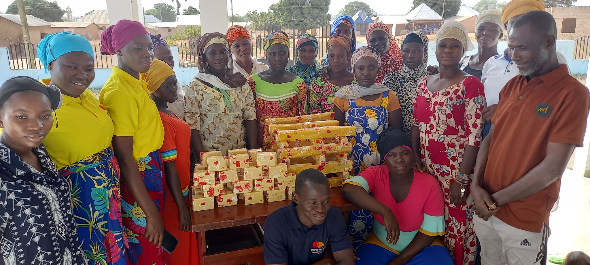
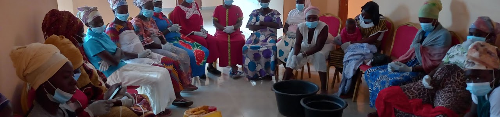
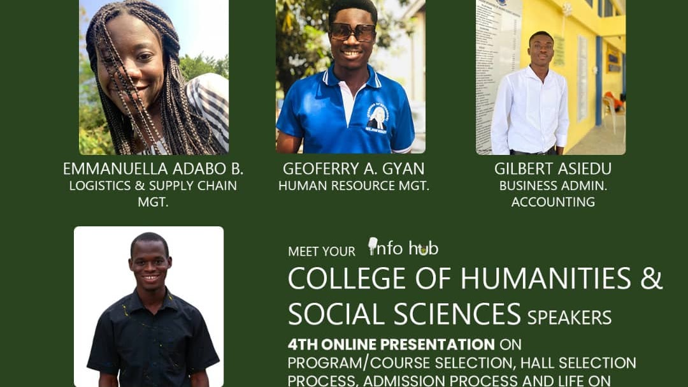
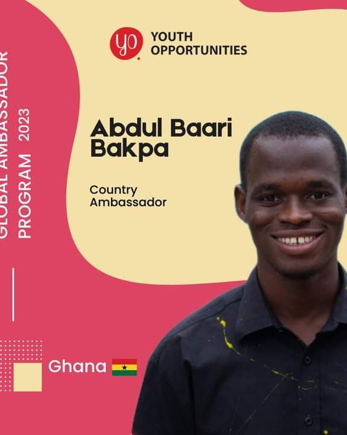

I have a wandering mind. Discover here what I am sometimes up to.

<i class="bi bi-people" aria-hidden="true"></i>Community service

<article class="community-article">
<h3>Monmua: skills training for women</h3>

Sorbelle, Sissala West District, Ghana · 2021

In 2021, I worked with three fellow Mastercard Foundation Scholars to train 20 women in making household detergents. The two-week programme aimed to provide an additional source of income alongside seasonal farming.

Follow-up showed that limited startup capital made it difficult for some participants to start or expand a business, highlighting the need to pair practical skills with financial support.

<figure></figure>
<figure></figure>

</article>

<article class="community-article">
<h3>UST Info Hub: student mentoring</h3>

I advised more than 200 prospective students on university applications, course choices, and admission requirements, and mentored 200 newly admitted students as they prepared for campus life.

This included guidance on registration and housing, alongside mentorship plans pairing new students with current students to support their academic and social transition.

<figure></figure>

</article>

<article class="community-article">
<h3>Youth Opportunities: Global Youth Ambassador</h3>

As a Global Youth Ambassador for Youth Opportunities, my work has included sharing scholarships, conferences, and competitions; supporting an online youth community; and helping organise sessions on applications and professional development.

Through partnerships, events, and contributions to the Circle platform, I have helped young people find and navigate educational and career opportunities.

<figure></figure>

</article>

<a href="https://sites.google.com/view/mrbakpa/community-service">More about my community service</a>

<svg class="stata-icon" viewBox="0 0 32 32" aria-hidden="true" focusable="false"><rect class="stata-icon-bg" x="1" y="1" width="30" height="30" rx="6"/><path d="M12 7h5v5h-5zM19 7h5v5h-5zM5 14h5v5H5zM12 14h5v5h-5zM19 14h5v5h-5zM5 21h5v5H5zM12 21h5v5h-5z" fill="#fff"/></svg>Statafun

Even the busiest minds need a little fun.

Inspired by the Stata packages <code>motivate</code> and <code>demotivate</code>, I created <code>statafun</code> to bring a little fun to coding tasks. It offers jokes, anagrams, and riddles right inside Stata, even without an internet connection.

<a href="https://github.com/abdulbaaribakpa/statafun">Explore statafun on GitHub</a>

<i class="bi bi-newspaper" aria-hidden="true"></i>News writing

For a while, I wanted to be a news writer. I changed course after publishing just two articles in <em>The African Dream</em>.

<h3><a href="https://www.theafricandream.net/mastercard-beneficiary-gives-back/">KNUST Mastercard Foundation Beneficiary Gives Back to His Community</a></h3>

A story about a scholarship beneficiary who donated school uniforms and supplies to pupils in Ghana's Sissala West District.

<h3><a href="https://www.theafricandream.net/%E2%80%8Bthe-499-legal-battle-of-ghana/">“The 499” Legal battle of the Attorney General and Parliament of Ghana</a></h3>

An article on the dispute over the admission of 499 qualified applicants to the Ghana School of Law.

